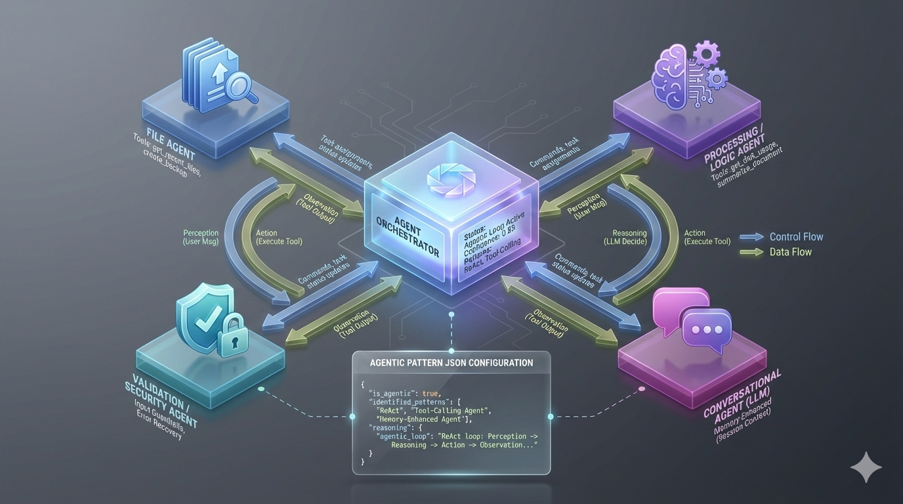

# Storify - File Manager NAS (NestJS)

Aplicación construida con NestJS para gestionar un "mini NAS" multiusuario en una red local:

- Navegador de archivos web: subida (drag & drop), previsualización, descarga, mover, renombrar y borrar.
- Carpeta privada por usuario y espacio compartido, con control de acceso por rol.
- Panel de administración con estadísticas de uso y backups ZIP completos e incrementales.
- Asistente conversacional (opcional) que consulta y organiza archivos mediante un LLM compatible con OpenAI.

El backend está escrito con NestJS y renderiza vistas Handlebars.

---

## Índice

- [Finalidad del proyecto](#finalidad-del-proyecto)
- [Roles y permisos](#roles-y-permisos)
- [Arquitectura agéntica](#arquitectura-agéntica)
- [Requisitos](#requisitos)
- [Configuración de entorno](#configuración-de-entorno)
- [Puesta en marcha en desarrollo](#puesta-en-marcha-en-desarrollo)
- [Calidad: tests, lint y CI](#calidad-tests-lint-y-ci)
- [Despliegue en producción](#despliegue-en-producción)
- [Backups](#backups)
- [Seguridad](#seguridad)
- [Licencia](#licencia)

---

## Finalidad del proyecto

Storify resuelve un escenario típico de almacenamiento compartido en una red local:

- Todos los usuarios comparten un directorio raíz común, `<STORAGE_PATH>/users/`.
- Cada usuario tiene **su propia carpeta** (`users/<USUARIO>`), creada al iniciar sesión, donde puede crear subcarpetas, subir, mover, renombrar y borrar archivos.
- Las carpetas y archivos de la raíz que no se llaman como un usuario son **compartidos** entre todos los usuarios normales.
- El administrador ve y gestiona todo, y dispone de un **dashboard** con uso de disco global, uso por usuario (más `OTROS` para lo compartido), tipos de archivo y gestión de backups.
- La interfaz está en español, sigue el tema claro u oscuro del sistema (con un botón para cambiarlo) y se puede usar entera con el teclado o en una pantalla táctil.
- Funciona **sin acceso a Internet**: fuentes y librerías se sirven desde el propio servidor (la única excepción es el proveedor de IA si es remoto).

La especificación funcional original está en `docs/base.md`; el sistema de diseño, en `design-system/storify-nas/DESIGN.md`.

---

## Roles y permisos

El rol se deduce del nombre de usuario:

| Usuario | Rol | Puede |
|---|---|---|
| `ADMIN` | admin | Todo bajo `users/`, dashboard y backups |
| `INVITADO` | invitado | **Solo lectura** sobre `<STORAGE_PATH>/public/` |
| Cualquier otro | miembro | Su carpeta y el espacio compartido de la raíz. No ve ni accede a las carpetas de otros usuarios |

Reglas adicionales, comunes a la web y al asistente:

- Nadie puede borrar, renombrar ni mover una raíz de almacenamiento; un miembro tampoco puede hacerlo con su propia carpeta de usuario.
- Un miembro no puede crear en la raíz una carpeta con el nombre de otro usuario.
- Las rutas se normalizan antes de comprobar permisos (`ALICE/../BOB` se evalúa como `BOB`), y se rechazan los enlaces simbólicos que salen de la raíz.

Toda esta lógica vive en `src/storage/access-policy.ts`.

---

## Arquitectura agéntica

Storify incluye un asistente conversacional que interactúa con el NAS mediante lenguaje natural. Sigue un patrón **ReAct (Reasoning + Acting)** con **tool-calling** y memoria conversacional por sesión.



### Ciclo agéntico

1. **Percepción**: el `ChatGateway` (Socket.IO) recibe el mensaje. El socket se autentica con la misma cookie de sesión que la web.
2. **Razonamiento**: el LLM decide si responder o llamar a una o varias herramientas.
3. **Acción**: las herramientas se ejecutan **como el usuario de la sesión**, con los mismos permisos que en el navegador de archivos.
4. **Observación**: los resultados se añaden a la conversación y el LLM continúa.
5. **Iteración**: hasta 12 pasos o 75 segundos por petición.

### Confirmación humana

Las herramientas que **modifican datos** (mover, crear carpetas, iniciar un backup) nunca se ejecutan directamente. El asistente propone la acción y el chat muestra los botones **Confirmar / Cancelar**. Esto protege frente a instrucciones maliciosas escondidas dentro de documentos (prompt injection). Una propuesta caduca a los 5 minutos y se anula si el usuario escribe otro mensaje.

### Herramientas disponibles

| Herramienta | Descripción | Notas |
|---|---|---|
| `get_disk_usage` | Lo que ocupan los archivos y el tamaño y espacio libre del disco | |
| `get_recent_files` | Archivos modificados recientemente | Solo los visibles para el usuario, máx. 50 |
| `list_documents_by_name` | Busca documentos `.txt`, `.docx`, `.pdf` por nombre | Solo los visibles para el usuario |
| `summarize_document` | Resume un documento | |
| `classify_file` | Clasifica un archivo y sugiere organización | Ver `docs/file_classification.md` |
| `move_file` | Mueve un archivo o carpeta | Requiere confirmación |
| `create_folder` | Crea una carpeta | Requiere confirmación |
| `create_incremental_backup` | Inicia un backup incremental | Solo admin; requiere confirmación |
| `get_suspicious_activity` | Ráfagas de logins fallidos y accesos denegados | Solo admin |

Las herramientas de administrador ni siquiera se ofrecen al modelo cuando el usuario no es admin.

### Proveedor de IA y privacidad

El asistente es **opcional**. Funciona con OpenAI (`OPENAI_API_KEY`) o con cualquier servidor compatible con la API de OpenAI, por ejemplo Ollama o vLLM en la propia red (`LLM_BASE_URL`). El modelo debe admitir tool calling. Al abrir el chat se informa al usuario de a qué proveedor se envían sus mensajes y el contenido de los documentos que pida resumir o clasificar.

Sin proveedor configurado, el resto de la aplicación funciona con normalidad y el chat indica que el asistente está desactivado.

Implementación: `src/agent/` (bucle en `agent.service.ts`, una herramienta por archivo en `tools/`).

---

## Requisitos

- Node.js 22 o superior (`engines` en `package.json`; es la versión usada en CI).
- pnpm (la versión exacta está fijada en `package.json` → `packageManager`; tras `corepack enable`, Node usa esa versión automáticamente).

---

## Configuración de entorno

Copia `.env.example` a `.env` y ajústalo. La aplicación **valida la configuración al arrancar** y se niega a iniciar si hay valores inseguros o mal formados, mostrando qué falta.

| Variable | Obligatoria | Descripción |
|---|---|---|
| `JWT_SECRET` | Sí | Secreto de sesión, mínimo 32 caracteres (`openssl rand -hex 32`) |
| `USERS` | Sí | Lista separada por comas, p. ej. `"ADMIN,ALICE,INVITADO"` |
| `USER_<NOMBRE>` | Sí, una por usuario | Contraseña de cada usuario. Recomendado: hash bcrypt (ver abajo) |
| `STORAGE_PATH` | No | Raíz del almacenamiento (por defecto `./public_storage`) |
| `TOTAL_STORAGE_GB` | No | Límite de almacenamiento en GB. Si se define, las subidas que lo superarían se rechazan (507); sin definir, se muestran 10 GB en el dashboard solo como referencia |
| `UPLOAD_MAX_FILE_SIZE_MB` / `UPLOAD_MAX_FILES` | No | Límites de subida (2048 MB por archivo, 10 archivos por petición) |
| `BACKUP_PATH` | No | Carpeta de backups (por defecto `<STORAGE_PATH>/backups`); idealmente en otro disco |
| `BACKUP_KEEP_FULL` | No | Backups completos que se conservan (por defecto 3) |
| `ADMIN_EMAIL` | No | Destinatario de los avisos de backup (de momento solo se registran en el log) |
| `OPENAI_API_KEY` | No | Activa el asistente con OpenAI |
| `LLM_BASE_URL` | No | Endpoint compatible con OpenAI, p. ej. `http://localhost:11434/v1` |
| `LLM_MODEL` | No | Modelo (por defecto `gpt-5-mini`) |
| `PORT` | No | Puerto HTTP (por defecto 3000) |
| `NODE_ENV` | No | Con `production`, la cookie de sesión se marca `Secure` (requiere HTTPS) |

Los nombres de usuario solo pueden contener letras, dígitos, `_` y `-`.

### Contraseñas con hash

```bash
pnpm hash-password        # escribe la contraseña (no se muestra) y pulsa Enter
```

Copia el resultado **con las comillas simples** en `.env`, p. ej. `USER_ALICE='$2b$12$...'`. Las contraseñas en texto plano siguen funcionando, pero la aplicación avisa al arrancar.

### Estructura del almacenamiento

```
<STORAGE_PATH>/
├── users/<USUARIO>/   carpetas privadas
├── users/<otras>/     carpetas y archivos compartidos
├── public/            espacio del invitado (solo lectura)
├── backups/           backups ZIP + manifiestos (si no se define BACKUP_PATH)
├── .tmp/              subidas en curso
├── .thumbs/           caché de miniaturas (se regenera sola; se puede borrar)
└── .audit/            registro de eventos de seguridad
```

---

## Puesta en marcha en desarrollo

```bash
pnpm install
cp .env.example .env      # y edítalo
pnpm run start:dev
```

- Login: `http://localhost:3000/`
- Navegador de archivos: `http://localhost:3000/files/browser`
- Dashboard (solo admin): `http://localhost:3000/admin/dashboard`

---

## Calidad: tests, lint y CI

```bash
pnpm test             # tests unitarios
pnpm run test:e2e     # e2e contra la aplicación completa y un almacenamiento temporal
pnpm run typecheck    # tsc --noEmit
pnpm run lint:check   # ESLint (con reglas de tipos)
```

GitHub Actions (`.github/workflows/ci.yml`) ejecuta build, typecheck, lint, formato y ambas suites de tests en cada push a `master` y en cada pull request.

pnpm está configurado para no instalar versiones de dependencias publicadas hace menos de 14 días (`minimumReleaseAge` en `pnpm-workspace.yaml`).

---

## Despliegue en producción

```bash
pnpm install --frozen-lockfile
pnpm run build
NODE_ENV=production pnpm run start:prod
```

Recomendaciones:

- **Reverse proxy con HTTPS** (Nginx, Traefik, Caddy). Con `NODE_ENV=production` la cookie de sesión solo viaja por HTTPS. Si el NAS se usa solo por HTTP en la LAN, no definas `NODE_ENV=production`.
- El proxy debe permitir WebSockets (para el chat) y un tamaño de subida acorde a `UPLOAD_MAX_FILE_SIZE_MB`:

  ```nginx
  location / {
      proxy_pass         http://127.0.0.1:3000;
      proxy_http_version 1.1;
      proxy_set_header   Upgrade $http_upgrade;
      proxy_set_header   Connection 'upgrade';
      proxy_set_header   Host $host;
      proxy_cache_bypass $http_upgrade;
      client_max_body_size 2g;
  }
  ```

- El usuario del sistema que ejecuta Node necesita lectura y escritura sobre `STORAGE_PATH` y `BACKUP_PATH`.
- La aplicación no necesita salida a Internet salvo que uses OpenAI: las librerías del cliente se sirven localmente. Solo las tipografías se cargan todavía desde Google Fonts.
- Al recibir `SIGTERM`/`SIGINT`, un backup en curso se cancela y su archivo parcial se elimina.

---

## Backups

Desde el dashboard (o el asistente, con confirmación) el administrador puede lanzar backups ZIP de `users/`:

- **Completos** e **incrementales**. Los incrementales incluyen los archivos nuevos o modificados desde el backup anterior y un `DELETED.txt` con los archivos borrados.
- **Escritura atómica**: el ZIP se escribe como `.zip.partial` y solo se renombra al terminar. Un backup fallido nunca sustituye ni borra los anteriores.
- **Retención**: tras cada backup completo correcto, se conservan los `BACKUP_KEEP_FULL` completos más recientes y sus incrementales.
- Cada backup tiene un manifiesto JSON con el estado de los archivos.
- "Download Latest Backup" descarga el **último backup completo**. `GET /admin/backup/list` lista todos.

---

## Seguridad

- Sesión con JWT en cookie `httpOnly` y `SameSite=strict`; el rol se recalcula desde la configuración en cada petición.
- Login limitado a 10 intentos por minuto por IP y usuario; intentos fallidos y accesos denegados quedan registrados en `.audit/events.jsonl`.
- Content-Security-Policy estricta (sin JavaScript inline) y cabeceras de seguridad con `helmet`.
- Todas las entradas de la API se validan; las rutas se comprueban siempre contra la política de acceso.
- La salida del asistente se sanea antes de mostrarse.

---

## Licencia

Este proyecto se distribuye bajo la **MIT License**. El texto completo está en [LICENSE](LICENSE).
